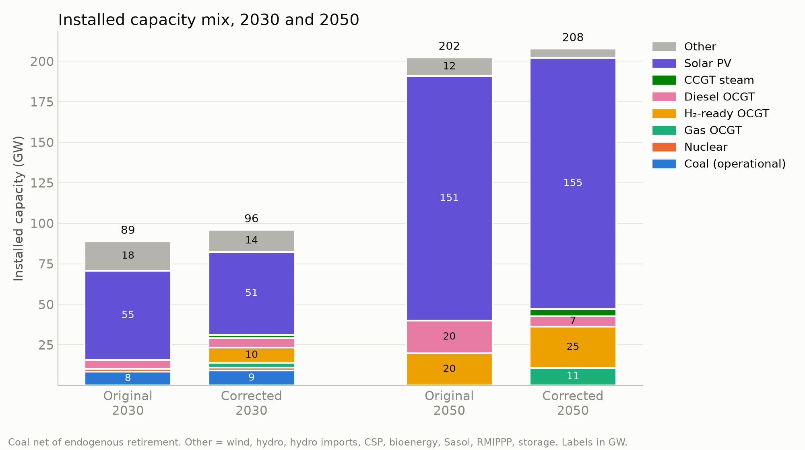
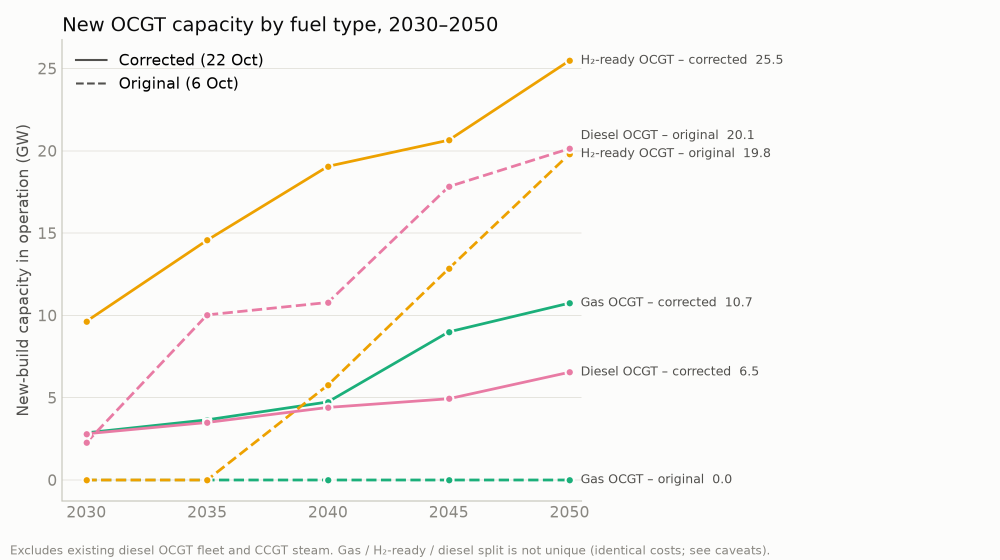
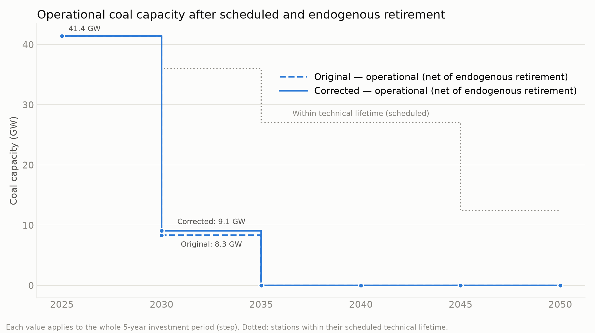
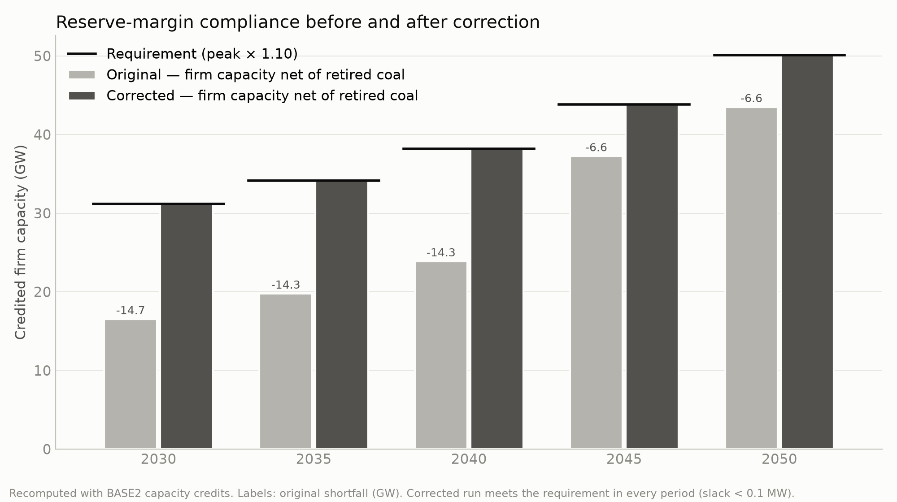

# REF-LC key results: original vs corrected run

**Original run:** 6 Oct 2026 · **Corrected run:** 22 Oct 2026 · 1 node, LC-182h, 2025–2050 · prepared 26 Oct 2026

Both runs were solved from identical network inputs: the same snapshots, weights, generators, profiles, marginal costs and demand (`elec.nc` verified equal). They differ only in two solve-stage changes:
1. the reserve-margin correction (retired coal no longer counts as firm capacity);
2. removal of the inherited 40%/30% minimum-generation floors on new gas.

All figures were extracted from the two `solved.nc` files and their `decom_status.csv` / `generator_emissions.csv` outputs. Full detail is in `notebooks/REF-LC_baseline_validation_2026-10-26.md`.

## 1. Headline results

Capacity in GW (new build in operation); costs in bn ZAR (present value at 9.2%).

| Metric | Original | Corrected | Change |
|---|---|---|---|
| Total system cost (objective) | 2,588.5 | 2,674.0 | +85.5 (+3.3%) |
| Reserve margin, net of retired coal, 2030–2050 | **Not met:** short by 14.7 (2030) to 6.6 (2050) GW | **Met** in every period | Compliance restored |
| New gas OCGT, 2030 / 2050 | 0.0 / 0.0 | 2.9 / 10.7 | +2.9 / +10.7 |
| New H₂-ready OCGT, 2030 / 2050 | 0.0 / 19.8 | 9.6 / 25.5 | +9.6 / +5.7 |
| New diesel OCGT, 2030 / 2050 | 2.3 / 20.1 | 2.8 / 6.5 | +0.5 / −13.6 |
| New CCGT steam, 2030 / 2050 | 0.0 / 0.0 | 1.7 / 4.4 | +1.7 / +4.4 |
| **Installed new OCGT-class + steam, 2030 / 2050** | 2.3 / 39.9 | 17.0 / 47.1 | +14.7 / +7.2 |
| Coal retired endogenously, cumulative, 2030 / 2035 | 27.7 / 36.0 | 26.9 / 36.0 | −0.8 / 0.0 |
| Operational coal remaining, 2030 / 2035 onward | 8.3 / 0.0 | 9.1 / 0.0 | +0.8 / 0.0 |
| CO₂ emissions, 2030 (Mt) | 41.9 | 51.5 | +9.6 |
| Load shedding (all periods) | ≈ 0 (4 × 10⁻⁵ MWh) | ≈ 0 (2 × 10⁻³ MWh) | none in either run |

Definitions:
- **Cumulative endogenous retirement** counts all coal capacity the model chose to close up to that period (36.0 GW = every station still within its technical life in 2030).
- **Operational coal** is capacity still within its scheduled lifetime minus endogenous retirements.
- **CO₂** is generation × emission factor and excludes stand-by emissions.

Not available from the saved outputs: reserve-margin shadow prices, and the solver optimality gap of the original run.

## 2. Key figures

All figures are in `notebooks/REF-LC_key_figures/` (PNG, 200 dpi, 16:9) and are regenerated by `make_figures.py`.

**Figure 1. Installed capacity mix, 2030 and 2050.**

**Figure 2. New OCGT capacity by fuel type, 2030–2050** (solid = corrected, dashed = original).

**Figure 3. Operational coal capacity after scheduled and endogenous retirement.**

**Figure 4. Reserve-margin compliance before and after correction.**

## 3. Main findings

1. **The original run did not satisfy its own reserve-margin policy.** Measured correctly, it was 14.7 GW short of firm capacity in 2030 and 6.6 GW short in 2050. The corrected run meets the requirement exactly in every period from 2030 to 2050 (Figure 4).
2. **Installed OCGT-class plus steam capacity rises and is built earlier.** The corrected run installs 7.2 GW more new OCGT-class and CCGT-steam capacity by 2050 (47.1 vs 39.9 GW), and 14.7 GW more in 2030 (17.0 vs 2.3 GW).
   This is extra *installed* capacity. It is credited towards the reserve margin, but at LC-182h much of it is rarely dispatched, so it should not be read as an equal gain in dependable supply.
3. **The technology mix within that capacity shifts towards gas and H₂-ready units.** New natural-gas OCGT goes from 0 to 10.7 GW, CCGT steam from 0 to 4.4 GW, and H₂-ready OCGT from 19.8 to 25.5 GW, while new diesel OCGT falls from 20.1 to 6.5 GW (Figure 2).
   Because these options have identical costs, the split between them is not unique (see caveats). The robust result is the higher total.
4. **Coal retirement is almost unchanged.** Both runs retire about 27 GW of coal endogenously in 2030 and all remaining coal by 2035, i.e. 36.0 GW cumulatively. The corrected run keeps 0.8 GW more coal in operation in 2030 (9.1 vs 8.3 GW; Figure 3).
5. **System cost rises 3.3%, and 2030 emissions rise by 9.6 Mt.** The higher cost reflects the additional firm capacity needed for compliance.
   In 2030, CO₂ rises from 41.9 to 51.5 Mt. The changes by source are:
   - **coal:** +6.5 Mt, from 6.3 TWh more generation;
   - **natural gas burned in OCGTs:** +4.2 Mt, from 6.4 TWh of output by not-yet-converted H₂-ready units;
   - **Sasol coal:** +0.4 Mt;
   - **diesel OCGT:** −1.1 Mt;
   - **Sasol gas:** −0.5 Mt.

   The corresponding generation shift is mainly away from wind. The corrected run builds no new wind (−15.2 TWh in 2030). The lost energy is replaced by coal, gas-fired OCGT and CCGT steam, with total solar almost unchanged.
   These changes are the joint outcome of both modelling changes and are not attributed to either one.

## 4. Important caveats

- **Two changes combined.** Every difference above reflects both the reserve-margin correction and the removal of the inherited gas minimum-generation floors. Their separate effects cannot be isolated without a run that applies only one of the two changes.
- **OCGT technology degeneracy.** New gas, H₂-ready and diesel OCGTs have identical capital cost, efficiency, lifetime and capacity credit. H₂-ready units also convert to hydrogen at no extra cost.
  The model is therefore largely indifferent between them, and the solver splits capacity across them arbitrarily. Treat the gas / H₂-ready / diesel breakdown as indicative; only the total OCGT-class capacity is robust.
- **Development resolution.** LC-182h averages demand and renewables over 182-hour blocks, so there is no day–night cycle, and the model has a single node. It is a reduced-resolution development configuration, not the final research setup.
  Capacity and cost comparisons are indicative. Utilisation and capacity-factor results are not reliable at this resolution.
